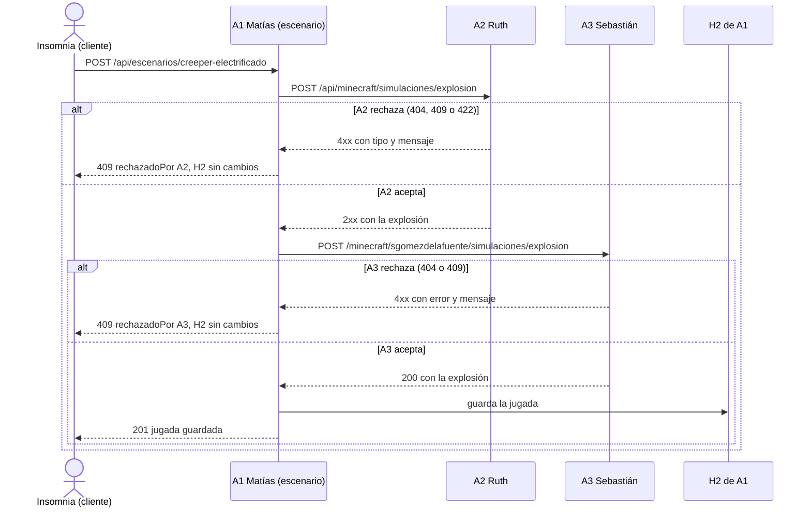
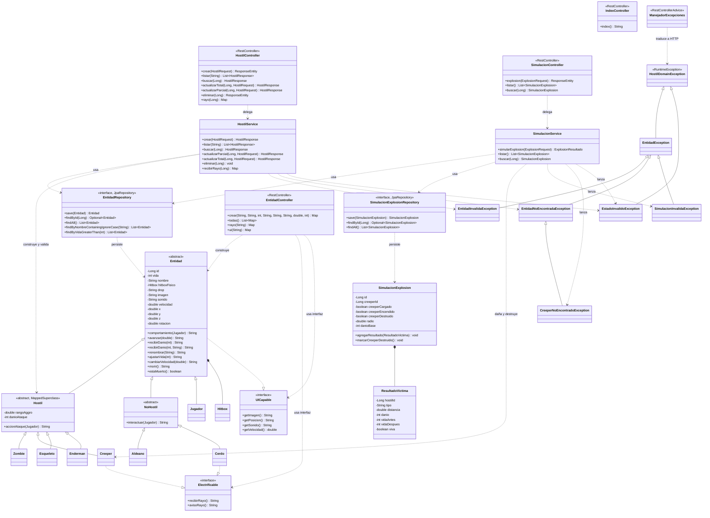

# mfdc-taller-git-2026 — POO-08 y POO-09

Servicio HTTP con **Spring Boot** sobre el dominio de **Minecraft** para el
ejercicio **POO-08 — Arquitectura en capas, persistencia, reglas de negocio e
invariantes de ciclo de vida**, de Lenguaje de Programación 3 (CYT646), y para
el challenge **POO-09 — APIs cruzadas**: el servicio publica su OpenAPI, consume
los servicios de dos compañeros y expone un escenario propio que solo guarda en
su H2 si los dos aceptan.

- **Alumno:** MFDC
- **Usuario de GitHub:** [Cemelele](https://github.com/Cemelele)
- **Comisión:** CYT646 F — trabajo individual
- **Repositorio:** <https://github.com/Cemelele/mfdc-taller-git-2026/tree/main>
- **Guía del taller:** [docs/TALLER_GIT.md](docs/TALLER_GIT.md)
- **Especificaciones del dominio:** [docs/ESPECIFICACIONES-POO-08.md](docs/ESPECIFICACIONES-POO-08.md)
- **Bitácora de uso de IA:** [BITACORA.md](BITACORA.md)
- **Colección de Insomnia (POO-08):** [docs/insomnia/insomnia_crud_hostil.json](docs/insomnia/insomnia_crud_hostil.json)
- **Colección de Insomnia (POO-09):** [docs/insomnia/poo-09-insomnia.yaml](docs/insomnia/poo-09-insomnia.yaml), con instrucciones en [docs/insomnia/README.md](docs/insomnia/README.md)
- **OpenAPI de este servicio:** `http://localhost:8080/v3/api-docs` y Swagger UI en `http://localhost:8080/swagger-ui.html`

## Estado actual de la entrega

- El paquete `py.edu.uc.lp3.domain` es una capa de dominio **pura**: las
  entidades solo guardan estado y lo mutan con métodos simples; no lanzan
  excepciones ni contienen validaciones.
- Las validaciones de datos, las reglas del juego y las invariantes de ciclo
  de vida viven en `HostilService` y `SimulacionService`.
- La persistencia usa **H2 en archivo** (`jdbc:h2:file:./data/entidades-db`) y
  Spring Data JPA con herencia `JOINED` y columna discriminadora `tipo`.
- La API responde con un JSON uniforme para errores **400**, **404** y
  **409 Conflict**.
- La suite actual ejecuta **60 tests** con `./mvnw test` (44 de POO-08, 11 de
  los clientes a Ruth y Sebastián y 5 del escenario de POO-09).
- POO-09: el servicio publica su OpenAPI, consume las APIs de A2 y A3 con
  `WebClient` y persiste su escenario solo si ambos compañeros aceptan.

## Enlace de la solución

Código, tests y documentación de la rama principal:

<https://github.com/Cemelele/mfdc-taller-git-2026/tree/main>

Commits exactos:

- POO-08 cerrado (validaciones en el service y ciclo de vida):
  <https://github.com/Cemelele/mfdc-taller-git-2026/commit/f27c84a>
- POO-08, documentación actualizada:
  <https://github.com/Cemelele/mfdc-taller-git-2026/commit/e24255e>
- POO-09, escenario `creeper-electrificado` con A2 y A3:
  <https://github.com/Cemelele/mfdc-taller-git-2026/commit/716a111>

El enlace al commit final de la entrega de POO-09 está en la tarea de
Classroom, porque un commit no puede contener su propio hash.

## Corrección de POO-08

Nota obtenida: **17/24**. Todas las observaciones de la corrección están
cerradas. El detalle de cómo se hizo cada cambio está en las sesiones 7 y 8 de
[BITACORA.md](BITACORA.md).

| Observación de la corrección | Cómo se cerró | Evidencia |
|---|---|---|
| **Criterio 2:** el dominio lanzaba excepciones (`IllegalArgumentException` en `Entidad`, `Hostil`, `Creeper`, `Aldeano`, `Enderman`, `Jugador`, `Hitbox`) | Se eliminaron los `throw` y las validaciones de `py.edu.uc.lp3.domain`, que solo guarda estado. Las validaciones y sus excepciones viven en `HostilService` y `SimulacionService` | [commit f27c84a](https://github.com/Cemelele/mfdc-taller-git-2026/commit/f27c84a) |
| **Criterio 3:** un `PATCH` con vida 20 revivía a un mob muerto | `HostilService` responde `409 Conflict` (`EstadoInvalidoException`) si se intenta subir la vida de una entidad con `vida <= 0`; el estado no cambia | [commit f27c84a](https://github.com/Cemelele/mfdc-taller-git-2026/commit/f27c84a), con tests nuevos |
| **Criterio 3:** un Creeper con vida 0 volvía a explotar y dejaba al Zombie con vida 0 | `SimulacionService` rechaza con `409` un Creeper sin vida o que ya explotó, sin tocar a las víctimas | [commit f27c84a](https://github.com/Cemelele/mfdc-taller-git-2026/commit/f27c84a), con tests nuevos |
| **Criterio 8:** propiedades de H2 sin explicar | Tabla con una frase por propiedad en «Configuración de H2 y JPA» | este README |
| **Criterio 8:** diagrama Mermaid desactualizado | El diagrama de arquitectura muestra `EntidadRepository`, los services, `HostilController`, `SimulacionController` y la familia de excepciones | este README |
| **Criterio 8:** las dos reglas del juego sin describir | Sección «Reglas del juego», una frase por regla | este README |
| **Criterio 8:** preguntas de «Qué hay que pensar» sin responder | Sección «Qué hay que pensar», con las tres respuestas | este README |
| **Criterio 8:** cómo importar y recorrer la colección de Insomnia | Sección «Importar y ejecutar la colección de Insomnia» | este README |
| **Criterio 8:** enlace al commit sin completar en el README | La sección «Enlace de la solución» trae los commits exactos | este README |
| **Criterio 8:** `ESPECIFICACIONES-POO-08.md` con un hash de commit inexistente | Se reemplazó por un enlace al commit exacto de la solución ([e24255e](https://github.com/Cemelele/mfdc-taller-git-2026/commit/e24255e)), que existe en GitHub | [docs/ESPECIFICACIONES-POO-08.md](docs/ESPECIFICACIONES-POO-08.md) |
| **Criterio 8:** la especificación decía H2 en memoria | Ahora indica H2 en archivo (`jdbc:h2:file:./data/entidades-db`), igual que `application.properties` | [docs/ESPECIFICACIONES-POO-08.md](docs/ESPECIFICACIONES-POO-08.md) |

## POO-09: APIs cruzadas (Minecraft)

La entrega y la nota son individuales. El grupo, de tres personas del mismo
juego, sirve para acordar a quién se consulta: cada uno es A1 de su entrega y
consulta a los otros dos.

### Mapa A1 / A2 / A3

| Rol | Persona | Repositorio | Servicio local | OpenAPI |
|---|---|---|---|---|
| **A1** (este repositorio) | Matías | [Cemelele/mfdc-taller-git-2026](https://github.com/Cemelele/mfdc-taller-git-2026) | `http://localhost:8080` | `http://localhost:8080/v3/api-docs` |
| **A2** | Ruth | [ruthsantacruzuca/rsantacruz-taller-git-2026](https://github.com/ruthsantacruzuca/rsantacruz-taller-git-2026) | `http://localhost:8081` | `http://localhost:8081/v3/api-docs` |
| **A3** | Sebastián | [SGDFM/sgomezdelafuente-talle-git-2026](https://github.com/SGDFM/sgomezdelafuente-talle-git-2026) | `http://localhost:8082` | `http://localhost:8082/v3/api-docs` |

Mi OpenAPI también lo consultan Ruth y Sebastián: usan
`POST /api/simulaciones/explosion`, que no se modificó en esta entrega.

### Reglas ajenas que uso

- **A2, Ruth** (`POST /api/minecraft/simulaciones/explosion`, cuerpo
  `{"creeperId":N}`): un Creeper con carga explota y daña a los demás mobs, con
  reacción en cadena. Rechaza con `404` si no existe, `422` si no tiene carga y
  `409` si ya explotó. El cuerpo de error trae `tipo` y `mensaje`.
- **A3, Sebastián** (`POST /minecraft/sgomezdelafuente/simulaciones/explosion`,
  cuerpo `{"creeperId":N,"jugadorId":N,"zombieId":N,"radio":N}`): el Creeper
  solo detona si está vivo y tiene una carga mínima de 3, y el daño es la carga
  por 4 (con carga 4 hizo 16 de daño). Rechaza con `404` y `409`. El cuerpo de
  error trae `status`, `error` y `mensaje`.

Las reglas propias que consumen mis compañeros están en «Reglas del juego»:
la electrificación y el ciclo de vida irreversible del Creeper.

### Mi escenario: `creeper-electrificado`

Hecho del juego: un Creeper electrificado por un rayo detona sobre un Zombie y
un Jugador. Necesita las dos validaciones ajenas: la de Ruth y la de Sebastián.

`POST /api/escenarios/creeper-electrificado` recibe:

```json
{
  "descripcion": "Creeper electrificado detona sobre un Zombie y un Jugador",
  "a2": { "creeperId": 4 },
  "a3": { "creeperId": 5, "jugadorId": 7, "zombieId": 6, "radio": 5 }
}
```

Los ids de `a2` y `a3` viven en las bases de datos de cada compañero. Los
detalles del flujo:

1. `EscenarioService` consulta primero a Ruth y después a Sebastián, sin
   transacción abierta durante las llamadas HTTP.
2. Solo si los dos aceptan, guarda la jugada en la tabla
   `escenario_creeper_electrificado` de mi H2 y responde `201`.
3. Si alguno rechaza, no guarda nada y responde `409` indicando quién rechazó.
   Si alguno no responde o se agota el tiempo, responde `502` con el origen.

Rechazo de Sebastián, por ejemplo:

```json
{
  "rechazadoPor": "A3",
  "companeroStatus": 409,
  "companeroError": "ExplosionNoPermitidaException",
  "mensaje": "El Creeper necesita una carga mínima de 3"
}
```

`GET /api/escenarios/creeper-electrificado` lista las jugadas guardadas; tras
un rechazo la lista no cambia.



**Por qué en ese orden.** Consulto primero a Ruth porque su contrato solo
necesita un `creeperId`, y así un rechazo de A2 no gasta datos de Sebastián al
probar. El costo es que si Ruth acepta y Sebastián rechaza, mi H2 queda igual
pero la base de Ruth ya cambió, con su reacción en cadena incluida. Son
procesos distintos y no hay una transacción que cubra a los tres servicios,
así que ese cambio no se puede deshacer. Es una limitación conocida.

### Cómo arrancar los tres servicios

Cada servicio se clona y arranca en su propio terminal, con puertos
distintos:

```bash
# A1 (este repositorio), puerto 8080
./mvnw spring-boot:run

# A2 (Ruth), puerto 8081
SERVER_PORT=8081 ./mvnw spring-boot:run

# A3 (Sebastián), puerto 8082
SERVER_PORT=8082 ./mvnw spring-boot:run
```

Las URLs de los compañeros se leen de `application.properties`
(`companeros.a2.base-url`, `companeros.a3.base-url` y las rutas
`companeros.a2.explosion-path` y `companeros.a3.explosion-path`). Se pueden
cambiar con las variables de entorno `A2_BASE_URL` y `A3_BASE_URL`; por
defecto apuntan a `http://localhost:8081` y `http://localhost:8082`.

### Cómo probarlo

Importar [docs/insomnia/poo-09-insomnia.yaml](docs/insomnia/poo-09-insomnia.yaml)
(instrucciones en [docs/insomnia/README.md](docs/insomnia/README.md)); trae el
entorno con las tres URLs, el escenario feliz, un rechazo de A2 y un rechazo de
A3. Cada explosión consume Creepers (la de Ruth además mata a otros mobs por
reacción en cadena), por lo que antes de cada prueba hay que crear mobs nuevos
en los servicios de Ruth y Sebastián y poner sus ids en el entorno. Hay un
ejemplo de cada respuesta en `docs/insomnia/respuestas/`.

## Requisitos y ejecución

Requisitos: **JDK 21**.

```bash
./mvnw spring-boot:run
```

El servicio queda en `http://localhost:8080`. Para detenerlo: `Ctrl+C`.

La consola web de H2 queda disponible en `http://localhost:8080/h2-console`
con la URL JDBC `jdbc:h2:file:./data/entidades-db`, usuario `sa` y contraseña
vacía.

## Configuración de H2 y JPA

Toda la configuración está en `src/main/resources/application.properties`.
Cada propiedad cumple una función concreta:

| Propiedad | Qué hace |
|---|---|
| `spring.application.name=mfdc-taller-git-2026` | Define el nombre lógico de la aplicación Spring Boot que aparece en logs y en la consola de administración. |
| `spring.datasource.url=jdbc:h2:file:./data/entidades-db` | Configura H2 con **persistencia en archivo** dentro de `./data/entidades-db`, por lo que los datos sobreviven al reinicio. |
| `spring.datasource.driverClassName=org.h2.Driver` | Indica el driver JDBC de H2 que usa el pool de conexiones. |
| `spring.datasource.username=sa` | Establece el usuario de conexión a la base H2. |
| `spring.datasource.password=` | Deja la contraseña vacía, válida para el entorno local de desarrollo. |
| `spring.jpa.hibernate.ddl-auto=update` | Hace que Hibernate cree las tablas faltantes y actualice el esquema sin borrar las filas existentes. |
| `spring.jpa.open-in-view=false` | Desactiva Open Session in View: la sesión de JPA se cierra al terminar la transacción del service/repository y no queda abierta durante el render HTTP. |
| `spring.h2.console.enabled=true` | Habilita la consola web de H2 para inspeccionar las tablas en desarrollo. |
| `spring.h2.console.path=/h2-console` | Publica la consola web de H2 en la ruta `/h2-console`. |

Los tests con `@DataJpaTest` reemplazan automáticamente esta configuración por
una base H2 embebida en memoria, de modo que no ensucian el archivo real de
`./data/entidades-db`.

## Dependencias principales (`pom.xml`)

| Dependencia | Uso en el proyecto |
|---|---|
| `spring-boot-starter-web` | API REST, `@RestController`, Jackson y servidor embebido. |
| `spring-boot-starter-data-jpa` | Repositorios Spring Data, Hibernate y transacciones. |
| `spring-boot-starter-validation` | Soporte de Bean Validation en el classpath de la aplicación. |
| `com.h2database:h2` | Base de datos H2 en archivo para desarrollo y ejecución local. |
| `spring-boot-starter-webflux` | `WebClient`, el cliente HTTP con el que se consumen los servicios de A2 y A3. |
| `springdoc-openapi-starter-webmvc-ui` | Publica el OpenAPI en `/v3/api-docs` y Swagger UI en `/swagger-ui.html`. |
| `spring-boot-starter-test` | JUnit 5, MockMvc, AssertJ y utilidades de test de Spring Boot. |

El proyecto usa Spring Boot `3.5.16`, Java `21` y el wrapper de Maven incluido
en el repositorio.

## Arquitectura y paquetes

```text
src/main/java/py/edu/uc/lp3/
├── Application.java                         arranque de Spring Boot
├── client/                                  clientes HTTP a los compañeros (POO-09)
│   ├── RuthClient.java                      A2: explosión de Ruth
│   └── SebastianClient.java                 A3: explosión de Sebastián
├── config/                                  beans WebClient
│   ├── CompanerosWebClientConfig.java       ruthWebClient y sebastianWebClient
│   └── WebClientConfig.java                 WebClient del prototipo de clase
├── domain/                                  dominio puro (sin HTTP ni JPA de negocio)
│   ├── Entidad.java                         raíz abstracta de la jerarquía
│   ├── Hostil.java                          @MappedSuperclass de mobs hostiles
│   ├── NoHostil.java                        mobs pasivos
│   ├── Jugador.java                         entidad jugador
│   ├── Zombie.java  Creeper.java            hijas persistidas de Hostil
│   ├── Esqueleto.java  Enderman.java        otras entidades hostiles
│   ├── Aldeano.java  Cerdo.java             entidades pasivas
│   ├── Hitbox.java                          valor embebido (ancho x alto)
│   ├── Electrificable.java                  capacidad de reaccionar a un rayo
│   └── UICapable.java                       contrato de datos para dibujar
├── repository/                              acceso a datos con Spring Data JPA
│   ├── EntidadRepository.java               JpaRepository<Entidad, Long>
│   ├── SimulacionExplosionRepository.java   JpaRepository<SimulacionExplosion, Long>
│   └── EscenarioCreeperElectrificadoRepository.java   escenario de POO-09
├── service/                                 capa de negocio y validaciones
│   ├── HostilService.java                   CRUD, validaciones y ciclo de vida
│   ├── SimulacionService.java               explosión, daño y electrificación
│   ├── EscenarioService.java                escenario con A2 y A3, sin transacción abierta
│   └── ObjetoExternoService.java            prototipo de clase con API pública
├── rest/controller/                         capa HTTP
│   ├── IndexController.java                 GET /
│   ├── EntidadController.java               endpoints de demostración del dominio
│   ├── HostilController.java                CRUD /api/hostiles
│   ├── SimulacionController.java            /api/simulaciones
│   ├── EscenarioController.java             /api/escenarios/creeper-electrificado
│   └── ObjetoExternoController.java         prototipo de clase con API pública
├── rest/dto/                                contratos de entrada y salida
│   ├── HostilDTO.java
│   ├── SimulacionDTO.java
│   ├── EscenarioDTO.java
│   └── ObjetoExternoDTO.java
├── model/                                   entidades persistidas de simulación
│   ├── SimulacionExplosion.java
│   ├── ResultadoVictima.java
│   └── EscenarioCreeperElectrificado.java   jugada guardada del escenario
└── exception/                               jerarquía de errores de dominio
    ├── HostilDomainException.java           base de todas las excepciones
    ├── EntidadException.java                base de errores de entidad
    ├── EntidadInvalidaException.java        400 Bad Request
    ├── EntidadNoEncontradaException.java    404 Not Found
    ├── CreeperNoEncontradoException.java    404 Not Found
    ├── SimulacionInvalidaException.java     400 Bad Request
    ├── EstadoInvalidoException.java         409 Conflict
    ├── EscenarioInvalidoException.java      400 Bad Request (escenario)
    ├── CompaneroRechazoException.java       409: A2 o A3 rechazó la jugada
    ├── CompaneroNoDisponibleException.java  502: A2 o A3 no responde
    ├── ManejadorApiExterna.java             handler del prototipo de clase
    └── ManejadorExcepciones.java            @RestControllerAdvice
```

## Diagrama de arquitectura



## Reglas del juego

- **Electrificación mediante `Electrificable`:** cuando un rayo alcanza a un
  `Creeper`, el service lo marca como cargado y su explosión pasa de 15 a 25
  puntos de daño base; el `Cerdo` implementa la misma capacidad y se
  transforma en Piglin Zombificado.
- **Simulación de explosión con ciclo de vida irreversible:** el daño de la
  explosión baja linealmente con la distancia y solo aplica dentro del radio,
  y el `Creeper` que detona muere (`vida = 0`) y no puede volver a explotar ni
  revivir, por lo que un segundo intento responde `409 Conflict`.

## Endpoints

| Método y ruta | Controller | Qué hace |
|---|---|---|
| `GET /` | `IndexController` | Confirma que el servicio está vivo |
| `GET /entidad/{tipo}` | `EntidadController` | Construye una entidad de demostración desde la URL |
| `GET /entidades` | `EntidadController` | Lista las entidades de demostración con su comportamiento |
| `GET /rayo/{tipo}` | `EntidadController` | Pide los mensajes de `Electrificable` |
| `GET /ui/{tipo}` | `EntidadController` | Devuelve imagen, posición, sonido y velocidad (`UICapable`) |
| `GET /api/hostiles` | `HostilController` | Lista hostiles persistidos; acepta `?nombre=` |
| `POST /api/hostiles` | `HostilController` | Crea un `zombie` o un `creeper` |
| `GET /api/hostiles/{id}` | `HostilController` | Busca un hostil por ID |
| `PUT /api/hostiles/{id}` | `HostilController` | Reemplaza nombre, vida, velocidad y atributos opcionales |
| `PATCH /api/hostiles/{id}` | `HostilController` | Actualiza solo los campos enviados |
| `DELETE /api/hostiles/{id}` | `HostilController` | Elimina un hostil |
| `GET /api/hostiles/{id}/rayo` | `HostilController` | Electrifica un Creeper persistido y devuelve el resultado |
| `POST /api/simulaciones/explosion` | `SimulacionController` | Simula y persiste una explosión de Creeper |
| `GET /api/simulaciones` | `SimulacionController` | Lista las simulaciones persistidas |
| `GET /api/simulaciones/{id}` | `SimulacionController` | Busca una simulación por ID |
| `POST /api/escenarios/creeper-electrificado` | `EscenarioController` | Consulta a Ruth (A2) y a Sebastián (A3) y guarda la jugada solo si ambos aceptan |
| `GET /api/escenarios/creeper-electrificado` | `EscenarioController` | Lista las jugadas guardadas del escenario |
| `GET /v3/api-docs` | springdoc | OpenAPI de este servicio |
| `GET /swagger-ui.html` | springdoc | Swagger UI |

Tipos válidos en `EntidadController`: `creeper`, `zombie`, `esqueleto`,
`enderman`, `cerdo`, `aldeano`. En `/rayo/{tipo}` responden `creeper` y
`cerdo`; en el CRUD persistido solo se aceptan `zombie` y `creeper`.

Ejemplos:

```bash
curl "localhost:8080/entidad/zombie?vida=35&danio=10&atacante=Creeper"
curl "localhost:8080/rayo/cerdo"
curl -i "localhost:8080/entidad/creeper?danio=-5"

curl -X POST "localhost:8080/api/hostiles" \
  -H "Content-Type: application/json" \
  -d '{"tipo":"creeper","nombre":"Boom","vida":20,"velocidad":0.25}'

curl -X POST "localhost:8080/api/simulaciones/explosion" \
  -H "Content-Type: application/json" \
  -d '{"creeperId":1,"cargado":true,"victimas":[{"hostilId":2,"distancia":1.5}]}'
```

`POST /api/simulaciones/explosion` devuelve `201 Created`; si la petición está
mal formada devuelve `400`; si el Creeper no existe, `404`; y si ya está muerto
o ya explotó, `409 Conflict`.

## Qué hay que pensar

### ¿Por qué las reglas van en el service y no en la entity?

Porque la entidad debe ser un objeto de dominio reutilizable y fácil de probar:
solo conserva atributos privados, constructores y métodos simples que mutan su
estado. Las validaciones de entrada, la decisión de aceptar o rechazar una
operación, el acceso al repositorio y la transacción pertenecen al service. Una
regla como “un mob muerto no revive” no depende solo del objeto, sino también
de la operación solicitada (`PUT`/`PATCH`) y del estado persistido; por eso se
controla en `HostilService` antes de mutar. La simulación de explosión
involucra varias entidades, distancias, daño y persistencia, así que vive en
`SimulacionService`. Así el dominio no lanza excepciones ni conoce HTTP, y las
validaciones están en un único lugar para todos los endpoints.

### ¿Cómo funciona la herencia JOINED con discriminador?

`Entidad` es la entidad raíz JPA (`@Entity`) y define
`@Inheritance(strategy = JOINED)` junto con
`@DiscriminatorColumn(name = "tipo")`. La tabla `entidad` guarda los campos
comunes y la columna `tipo`. Las clases persistidas hijas, `Zombie` y
`Creeper`, usan `@DiscriminatorValue` y tienen su propia tabla (`zombie` o
`creeper`) cuya clave primaria es también clave foránea hacia `entidad.id`.
Al leer, Hibernate usa `tipo` para saber qué subclase instanciar y hace un
`JOIN` por `id` para recuperar las columnas específicas. `Hostil` no genera
tabla porque es `@MappedSuperclass`: solo aporta campos y comportamiento a sus
hijas. `EntidadRepository` trabaja con el tipo padre y aun así devuelve
instancias concretas.

### ¿Cómo se manejan los códigos HTTP 400, 404 y 409?

`ManejadorExcepciones` es un `@RestControllerAdvice` que traduce cada
excepción de dominio a un JSON uniforme con `status`, `error`, `tipo` y
`mensaje`:

- **400 Bad Request:** la petición trae datos inválidos o incompletos
  (`EntidadInvalidaException`, `SimulacionInvalidaException`), por ejemplo
  nombre vacío, vida no positiva, velocidad negativa o distancia negativa.
- **404 Not Found:** el recurso pedido no existe
  (`EntidadNoEncontradaException`, `CreeperNoEncontradoException`).
- **409 Conflict:** la petición es válida, pero el estado actual no permite la
  operación (`EstadoInvalidoException`), por ejemplo intentar revivir una
  entidad con `vida <= 0` o explotar de nuevo un Creeper ya destruido.

## Importar y ejecutar la colección de Insomnia

1. Levantá la aplicación con `./mvnw spring-boot:run` y esperá a que escuche en
   `http://localhost:8080`.
2. Abrí Insomnia.
3. Entrá a **Application → Import/Export → Import Data → From File** (en
   algunas versiones aparece como **Import → From File**).
4. Seleccioná `docs/insomnia/insomnia_crud_hostil.json` desde la raíz del
   repositorio.
5. Elegí el workspace/proyecto destino y confirmá la importación; Insomnia
   detecta el formato del archivo y crea las solicitudes.
6. Verificá que las URLs de las solicitudes apunten a `http://localhost:8080`
   y ejecutá cada una con **Send**, en orden: primero crear un `zombie` y un
   `creeper`, después listar, consultar, actualizar y finalmente simular la
   explosión.
7. Repetí la simulación sobre el mismo Creeper para comprobar el
   `409 Conflict` del ciclo de vida irreversible.

La colección de POO-09 (`docs/insomnia/poo-09-insomnia.yaml`, formato Insomnia
v5) se importa igual y trae su propio entorno con `a1_url`, `ruth_url` y
`seb_url`; sus instrucciones están en
[docs/insomnia/README.md](docs/insomnia/README.md).

## Tests

```bash
./mvnw test
```

La suite suma **60 tests**: los 44 de POO-08 que detalla la tabla, 11 de los
clientes a Ruth y Sebastián (éxito, rechazos, timeout y servidor caído) y 5 del
escenario (feliz, rechazo de A2, rechazo de A3 y caída de cada uno).

| Test | Cantidad |
|---|---:|
| `ApplicationTests` | 1 |
| `domain/EntidadTest` | 13 |
| `repository/EntidadRepositoryTest` | 2 |
| `service/HostilServiceTest` | 4 |
| `service/SimulacionServiceTest` | 6 |
| `rest/controller/EntidadControllerTest` | 12 |
| `rest/controller/ManejadorExcepcionesTest` | 6 |
| **Total POO-08** | **44** |

## Licencia

[Apache License 2.0](LICENSE): se puede usar, modificar y distribuir (incluso
comercialmente) acreditando el origen y sin garantías.
